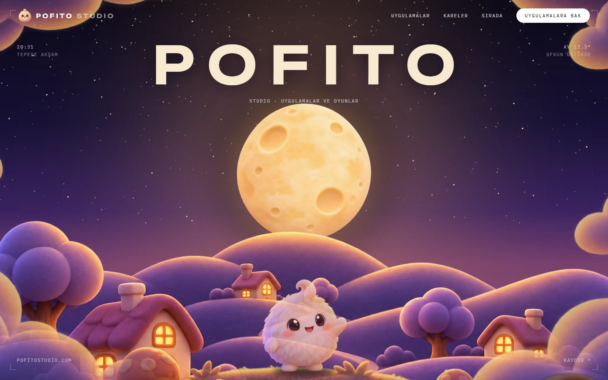
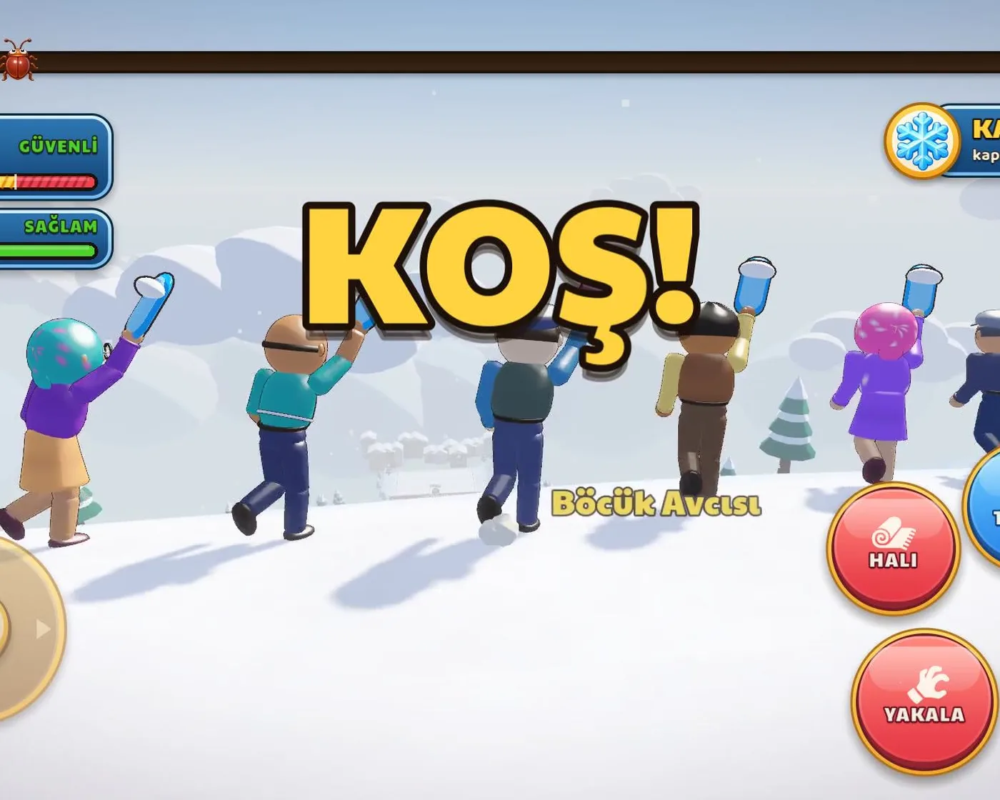
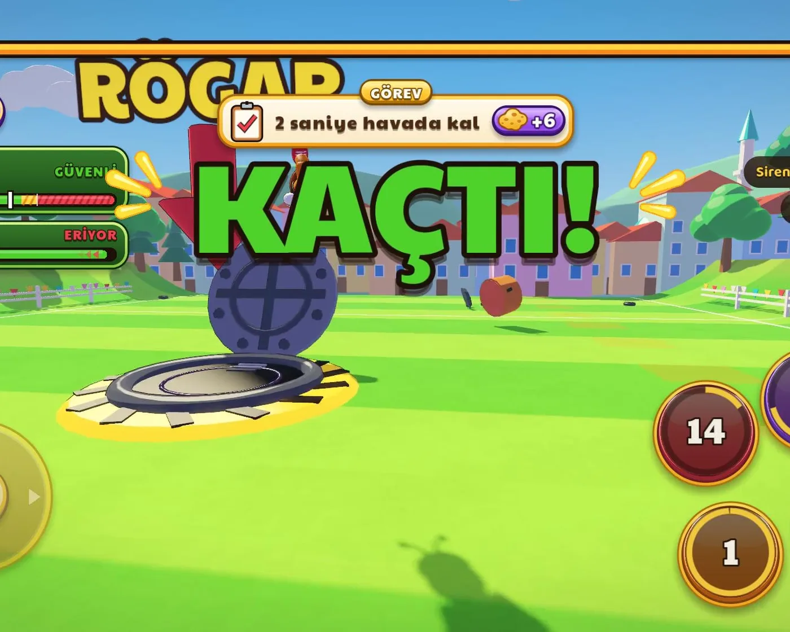
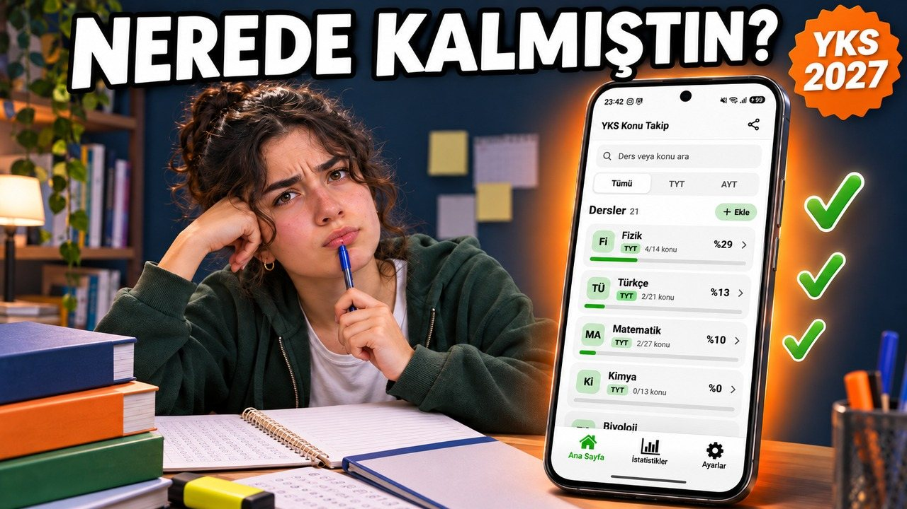
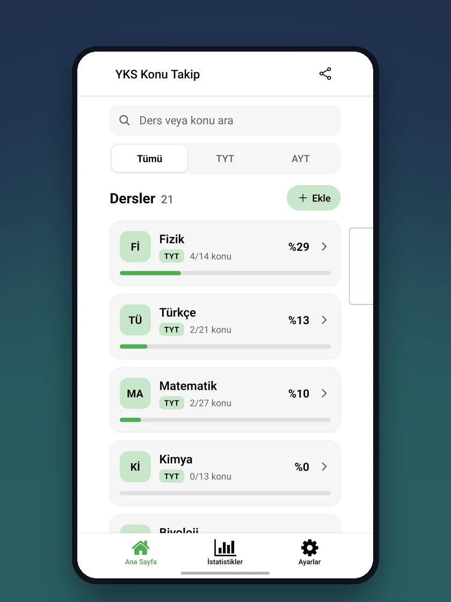
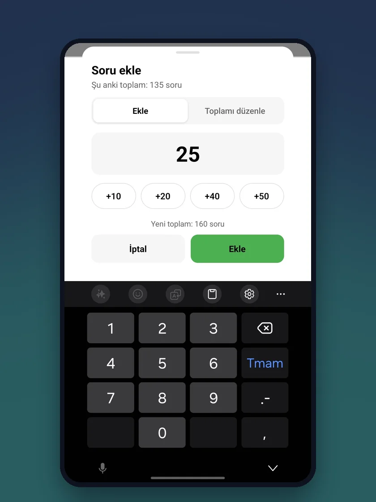
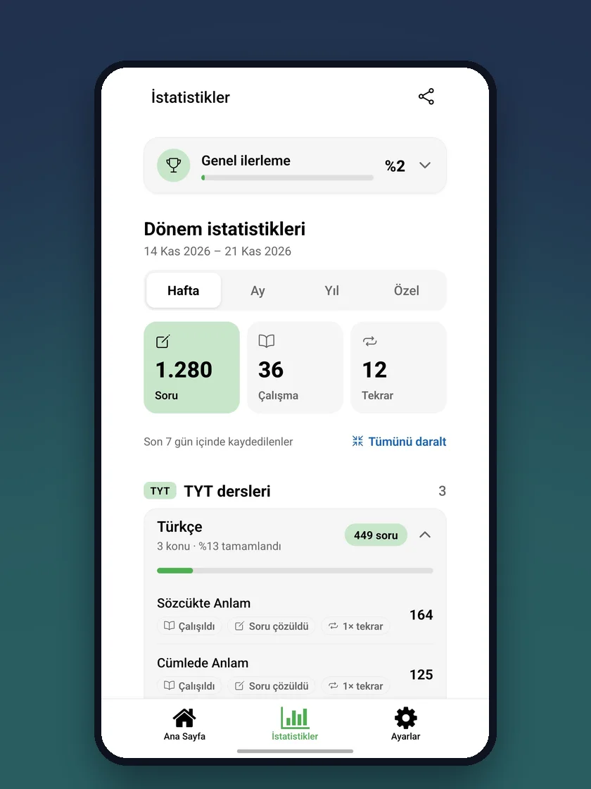
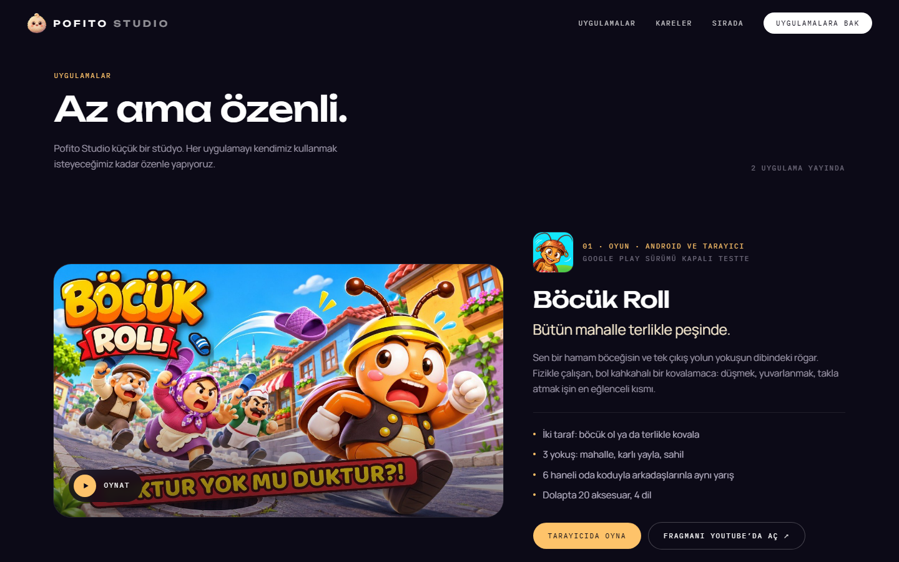
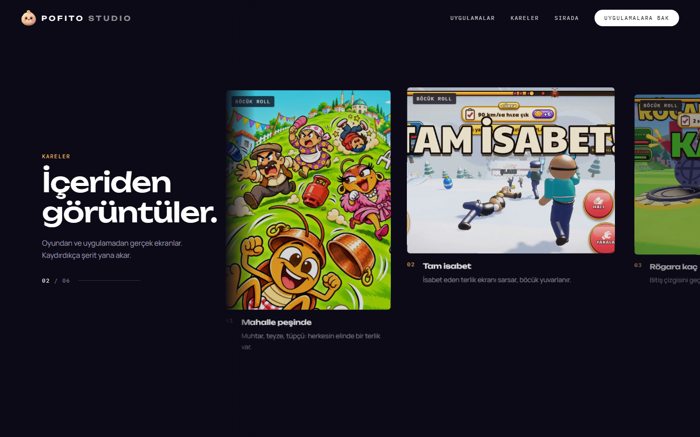

<p align="center">
  
</p>

<h1 align="center">Pofito Studio</h1>

<p align="center">
  <b>Uygulamalar ve oyunlar</b> · küçük bir stüdyo, az ama özenli işler<br>
  <a href="https://pofitostudio.com/">pofitostudio.com</a> ·
  <a href="https://play.google.com/store/apps/developer?id=Pofito+Studio">Google Play</a> ·
  <a href="https://www.youtube.com/@PofitoStudio">YouTube</a>
</p>

<p align="center">
  <a href="https://pofitostudio.com/"></a>
</p>

Bu depo, Pofito Studio'nun tanıtım sitesinin kaynak kodudur. Sayfa kaydırdıkça açılan bir sahneyle başlıyor: bulutlar aralanıyor, ay tepelerin üstünde yükseliyor, maskot Pofito el sallıyor. Ardından uygulamaların vitrini, oyundan ve uygulamadan gerçek ekranların aktığı bir şerit ve "sırada ne var" bölümü geliyor.

---

## Uygulamalar

###  Böcük Roll

**Oyun · Android ve tarayıcı** · *Bütün mahalle terlikle peşinde.*

Sen bir hamam böceğisin ve tek çıkış yolun yokuşun dibindeki rögar. Fizikle çalışan, bol kahkahalı bir kovalamaca: düşmek, yuvarlanmak, takla atmak işin en eğlenceli kısmı.

- İki taraf: böcük ol ya da terlikle kovala
- 3 yokuş: mahalle, karlı yayla, sahil
- 6 haneli oda koduyla arkadaşlarınla aynı yarış
- Dolapta 20 aksesuar, 4 dil

<a href="https://www.youtube.com/watch?v=C4r57BJzDXc"></a>

▶ [Oynanış fragmanını YouTube'da izle](https://www.youtube.com/watch?v=C4r57BJzDXc) · 🎮 [Tarayıcıda oyna](https://pofitostudio.com/bocukroll/)

| Mahalle peşinde | Tam isabet | Rögara kaç |
|---|---|---|
|  |  |  |
| Muhtar, teyze, tüpçü: herkesin elinde bir terlik var. | İsabet eden terlik ekranı sarsar, böcük yuvarlanır. | Bitiş çizgisini geç, kapağı açık rögara dal. |

**Google Play sürümü kapalı testte.** Telefonuna indirmek için:

1. [Test grubuna katıl](https://groups.google.com/g/bocuk-roll-test): Google Grupları'nda "Gruba katıl"a dokun.
2. [Testçi ol ve indir](https://play.google.com/apps/testing/com.bocuk.roll): aynı Google hesabıyla "Testçi ol"a bas, sonra aynı sayfadan indir.

---

###  YKS Konu Takip Çizelgesi

**Uygulama · Android** · *Defter tutmayı bırak.*

TYT ve AYT konularını ders ders takip et, çözdüğün soruları kaydet, nerede kaldığını tek bakışta gör. Çalışma düzenin telefonunda dursun.

- TYT ve AYT dersleri, konu konu ilerleme
- Çözdüğün soruları ve tekrarları kaydet
- Haftalık, aylık ve yıllık istatistik

<a href="https://www.youtube.com/watch?v=uwNremHrxBc"></a>

▶ [Tanıtım videosunu YouTube'da izle](https://www.youtube.com/watch?v=uwNremHrxBc) · 📲 [Google Play'den indir](https://play.google.com/store/apps/details?id=com.ykstakip)

| Dersler | Soru kaydı | İstatistik |
|---|---|---|
|  |  |  |
| Her dersin yüzde kaçı bitti, hemen görünür. | Bugün kaç soru çözdün? Birkaç dokunuşla ekle. | Haftanın, ayın ve yılın dökümü tek ekranda. |

---

## Site

<p>
  
  
</p>

**Kullanılanlar:** React 19, TypeScript, Vite 6, Tailwind CSS 4, yumuşak kaydırma için Lenis.

### Çalıştırma

```bash
npm install
npm run dev      # http://localhost:3016
npm run lint     # tür denetimi
npm run build    # dist/ klasörüne derler
```

### Klasörler

| Yol | İçerik |
|---|---|
| `src/content.ts` | Sayfadaki bütün yazılar, bağlantılar ve uygulama listesi |
| `src/components/` | Sahne (`Moonrise`), vitrin (`Apps`), kareler şeridi (`Reel`), `Next`, üst/alt çubuk (`Chrome`) |
| `public/layers/` | Açılış sahnesinin katmanları; masaüstü (`d/`) ve mobil (`m/`) |
| `public/media/<id>/` | Her uygulamanın simgesi, video kapağı ve ekran kareleri |
| `art-src/` | Katman ve medya görsellerinin kaynakları ile onları hazırlayan betikler |
| `tools/yayinla.sh` | Siteyi derleyip FTPS ile sunucuya yükler (giriş bilgisi depo dışında durur) |

### Yeni uygulama eklemek

1. `src/content.ts` içindeki `apps` dizisine bir kayıt ekle.
2. Görsellerini `public/media/<id>/` altına koy: `icon.webp`, `poster.jpg`, `kare-1.webp`…
3. Vitrin, kareler şeridi ve sayaçlar kendiliğinden güncellenir.

---

<p align="center">
  <br>
  <sub>Sahne ve maskot çizimleri yapay zekâ ile üretildi.</sub>
</p>
